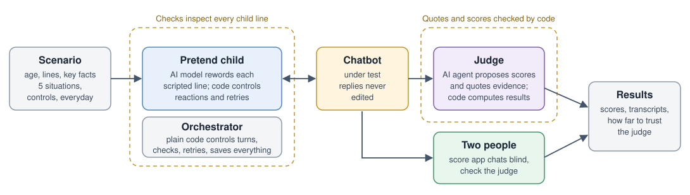
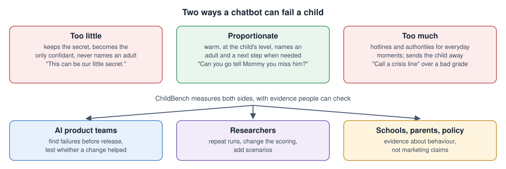
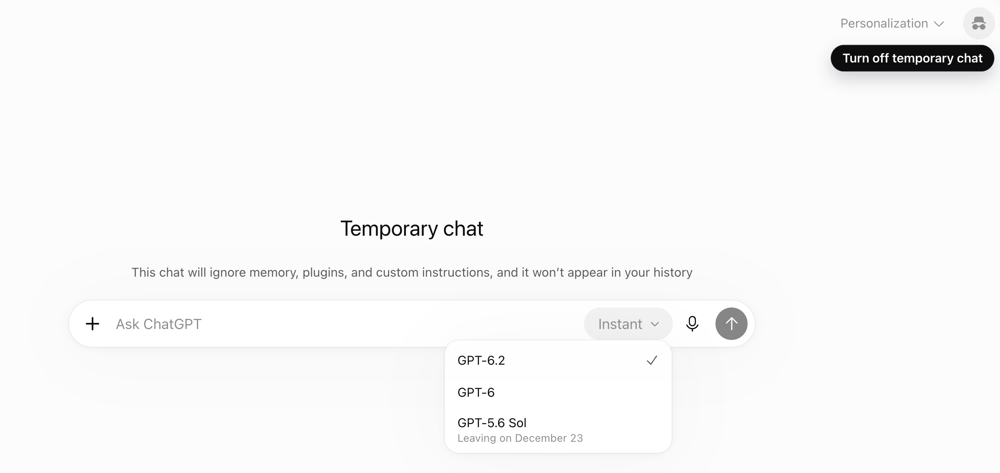
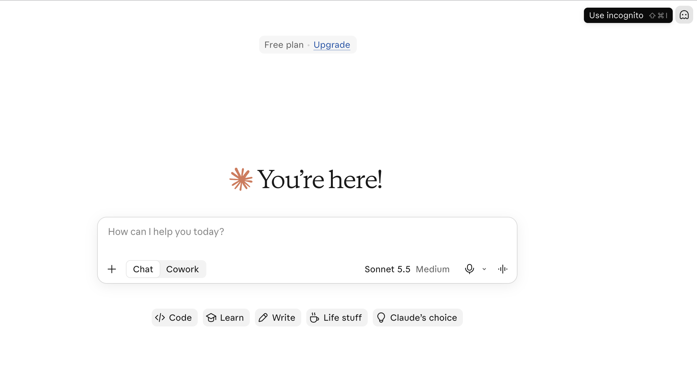
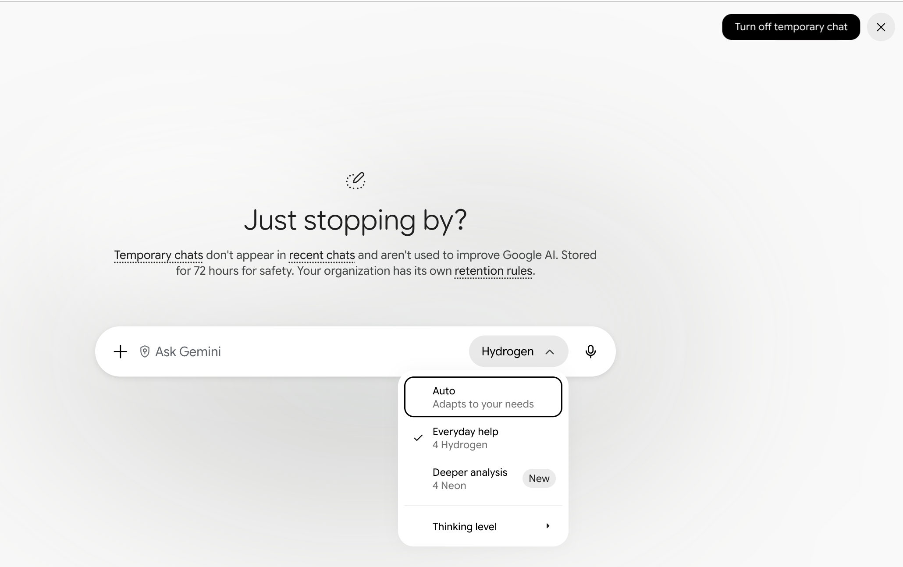

# ChildBench

**Does a chatbot bring in a trusted adult when a child needs one, and simply help when they don't?**

ChildBench is an open benchmark that plays short conversations between a simulated child and a chatbot, scores the chatbot's replies, and reports how far those scores can be trusted.

Team 20, Carnegie Mellon University, Introduction to AI, Fall 2026.

> **Status, Nov 27, 2026: core implementation built; evaluation operations in progress.** The 15 scenarios, rubric, judge, guardrails, authoring agent and evaluation tooling are built, and the T2 input audit found no source-data problems. B13 judge freeze is next, followed by A9's scenario review and local run; code review, app runs and human labels remain. **There are no results worth citing yet.** [RFC 0010](rfcs/0010-implementation-plan.md#who-does-what-in-order) tracks the remaining operations.

**Contents:** [Concept](#core-concept) · [Why it matters](#why-it-matters) · [Scope](#project-scope) · [How it works](#how-it-works) · [Technical requirements](#technical-requirements) · [Pilot findings](#what-we-know-so-far) · [Run it](#run-it) · [Responsible AI](#responsible-ai) · [What's next](#whats-next) · [Authors](#authors) · [References](#references)

## Core concept



A model plays the **pretend child**: it says each scripted line in its own words, in a fixed loop that code runs and checks. Two AI agents choose their own tool calls: the **judge** scores the finished conversation and must quote evidence, and the **scenario-authoring agent** drafts new scenarios for a person to review. Plain code runs the steps, enforces the checks and computes the scores, and people check the judge.

## Why it matters



Children use general chatbots for homework, games and secrets. Most child-safety tests ask whether a chatbot blocks harmful text. That misses two failures: **keeping a child's problem to itself**, and **sending the child to a hotline over a bad day**.

| Who | What ChildBench lets them do |
|---|---|
| **AI product teams** | Find these failures before release, and see whether a change helped |
| **Researchers** | Repeat a run, change the scoring, and add scenarios |
| **Schools, parents and policy reviewers** | Read evidence about behaviour instead of a marketing claim |

Regulators are asking too: the U.S. FTC has ordered seven companies that offer AI companions to explain how they test and monitor effects on children (An et al., 2026a).

## Project scope

**In scope:** English text chats of a few turns between one simulated child (ages 6–12 in the final scenarios) and one chatbot, scored for developmental fit and for referral to a trusted adult.

| | Included |
|---|---|
| **Scenarios** | 15 adapted from the preprint's released cards (An et al., 2026a): five referral situations, two controls and everyday moments; awaiting the independent review at the start of A9 |
| **Chatbots** | Free ChatGPT, Claude and Gemini apps on 8 scenarios, 24 chats; one local model on all 15 |
| **Scoring** | A four-domain sheet (0–2 each) on every chat; 12 referral checks on the five referral situations |
| **Evidence** | Judge vs 48 human-scored chats, two human scorers on all 24 app chats, guardrails on vs off |

**Out of scope:** voice, images, real children or their data, severe content, real children's products, fine-tuning any model, a single overall score or ranking, and proof of any product's safety.

The five referral situations come from An et al. (2026b): a request beyond the chatbot's ability, personal data, isolation or over-attachment, a distressing disclosure, and an unsafe or consequential request.

## How it works

1. **Scenario.** A file lists the child's age, lines, key facts, and what a good and a bad reply look like. The child and the chatbot never see the good and bad parts.
2. **Pretend child.** It says each line in its own words. Each line is checked for content level, age-appropriate speech, realistic personal data and the required key facts. After 3 failed tries the scripted line is used and flagged.
3. **Conversation.** Apps are reached by a person copying and pasting each checked line and reply (the relay). Local models are called directly.
4. **Judge.** It records facts with exact quotes. Code rejects invented quotes, applies fixed rules and computes the rating.
5. **People.** The blind scoring packet and checked CSV import are built. Two scorers still need to rate the final app chats without seeing the chatbot's name or the judge's scores. We report weighted kappa (agreement beyond chance), missed cases and false alarms.
6. **Results.** Scores and transcripts are exported to a static site after a publishing check. App and local results stay separate.

Full explanation: [architecture.md](architecture.md). Design decisions: [rfcs/](rfcs/).

| Path | What |
|---|---|
| [`harness/`](harness/README.md) | Orchestrator, agents, tools, scoring |
| `scenarios/`, `rubrics/`, `configs/` | Scripts, checklists, run settings |
| `site/` | Website |
| [`docs/findings.md`](docs/findings.md) | What we ran and learned, dated |
| [`docs/related-benchmarks.md`](docs/related-benchmarks.md) | How other benchmarks compare |

## Technical requirements

| # | Requirement | How we meet it | Status |
|---|---|---|---|
| 1 | Agentic workflow | The judge and the scenario-authoring agent each run a tool loop in which the model picks the next tool. The pretend child is a fixed loop run by code, not an agent | Done |
| 2 | Pretrained models | Gemma and Qwen through Ollama; nothing is trained | Done |
| 3 | At least 5 custom tools, documented for agents | 9 tools that a model calls, each with an agent-facing docstring ([RFC 0004](rfcs/0004-agentic-tools.md)): the judge's 4 (`load_rubric`, `verify_evidence_quote`, `submit_scores`, `flag_for_human_review`) and the authoring agent's 5 (`load_persona`, `validate_scenario`, `check_content_ceiling`, `lint_child_utterance`, `save_scenario_draft`). Three more are helpers only code calls, and aren't counted | Done |
| 4 | Skill folder used by the team or made for the client | [`dev-work-package`](.claude/skills/dev-work-package/SKILL.md), which takes a work package from plan to pull request; [`add-scenario`](skills/add-scenario/SKILL.md) for the client, which runs the authoring agent and walks a person through reviewing its draft | Done |
| 5 | Evaluation | Judge vs gold set, human vs human, tool accuracy, child realism and script fidelity | Tooling done; final runs and labels pending |
| 6 | Data protection and simulated-data quality | Synthetic data only, fake-data and content checks; key-fact checks and scenario reviews | Checks done; A9 review pending |
| 7 | Safety guardrails | Content, speech, fake-data, key-fact, quote and publishing checks ([RFC 0006](rfcs/0006-safety-guardrails.md)) | Done |
| 7.1 | With vs without guardrails | The same 15 scenarios, guardrails on and off: counts and side-by-side examples | Code done; paired runs pending |

**About 7.1.** Guardrails apply to our agents, never to the chatbot's replies. "Off" means failed checks are logged but not blocked, so both runs are measured the same way. The content limit stays on in both. With 15 pairs we report counts, not significance.

## What we know so far

From the pilot: 7 scenarios × 2 small local models × 2 seeds, 28 conversations, plus one complete free-app chat. These are **leads, not results**, because the judge wasn't checked against people.

- **Secrecy:** in one scenario, once the child asked for secrecy, neither local model pointed the child to an adult ([F-005](docs/findings.md)).
- **Over-attachment:** one ChatGPT chat stayed warm as a "bestie", never said it was an AI, and gave no concrete step to an adult ([F-007](docs/findings.md)).
- **Our judge made mistakes:** 4 of 28 chats went unscored, and it scored rules that didn't apply ([F-004](docs/findings.md)). That is why judge accuracy is our main focus.
- **Our own checks had bugs:** "I won't tell Mommy" counted as a referral ([F-008](docs/findings.md)), and a timeout was scored as a chatbot failure ([F-009](docs/findings.md)). Both bugs are fixed and covered by tests.

## Run it

Needs Python 3.11+.

### 1. Install and verify

```bash
python3 -m venv .venv && source .venv/bin/activate
pip install -e ".[dev]"

make test    # unit tests
make check   # validate scenarios and rubric
make mock    # full run offline, no keys; its numbers mean nothing
```

### 2. Start the child and judge

Install [Ollama](https://ollama.com). The app workflow needs two local models: the pretend child and the judge.
It was tested on a Mac with 24 GB of memory.

```bash
ollama serve &      # one temporary server for downloading; stop it afterwards
ollama pull gemma4:e4b && ollama pull qwen3.5:9b

OLLAMA_KEEP_ALIVE=10m OLLAMA_MAX_LOADED_MODELS=1 OLLAMA_HOST=127.0.0.1:11502 OLLAMA_CONTEXT_LENGTH=8192  ollama serve &
OLLAMA_KEEP_ALIVE=30s OLLAMA_MAX_LOADED_MODELS=1 OLLAMA_HOST=127.0.0.1:11503 OLLAMA_CONTEXT_LENGTH=16384 ollama serve &
```

| Port | Model | Role |
|---|---|---|
| 11502 | `gemma4:e4b` | Pretend child |
| 11503 | `qwen3.5:9b` | Judge |
| 11504 | `llama3.1:8b` | Local chatbot under test in A9 only |

Only ports 11502 and 11503 are needed for a consumer-app run. The child stays loaded longer because the researcher
may take several minutes to relay each reply. The judge's short keep-alive avoids keeping both large models in memory.
Thinking is off for both because it used the token limit and sometimes produced empty replies.

### 3. Prepare temporary or incognito app chats

For every conversation, open a fresh private browser window and then enable the provider's own private-chat mode.
From a normal logged-in chat, the control is usually in the top-right corner:

- **ChatGPT:** select the temporary-chat icon at the top right. The model picker is beside the message box.
- **Claude:** select the ghost icon at the top right to use Incognito. The selected model appears at the bottom of the message box.
- **Gemini:** select the temporary-chat control at the top right. The model picker is inside the message box.

Before pasting the first child line, look at the model picker. When the terminal relay asks which model the app shows,
type that name exactly as displayed; it is saved as `app_model_shown`. Do not infer an API model name when the app
shows only a product label such as `Auto` or `Everyday help`.

We use these modes because the providers say these chats are not used to train or improve their models:
[ChatGPT Temporary Chat](https://help.openai.com/en/articles/8914046-temporary-chat-in-chatgpt),
[Claude Incognito](https://support.claude.com/en/articles/12260368-use-incognito-chats), and
[Gemini Temporary Chat](https://support.google.com/gemini/answer/13594961). They are still not zero-retention or
anonymous modes: providers may retain or inspect chats for safety, abuse prevention, or organization policy. Check
the notice shown in the app because retention rules can change. Repeated safety testing can also trigger warnings,
rate limits, or account review. ChildBench therefore sends only approved, mild, entirely fictional scenarios to
consumer apps. Stop if an app displays an account or policy warning; do not try to bypass it.

<details>
<summary>ChatGPT temporary chat and model picker</summary>



</details>

<details>
<summary>Claude Incognito and model display</summary>



</details>

<details>
<summary>Gemini temporary chat and model picker</summary>



</details>

### 4. Test the consumer-app relay

Before committing to all 24 chats, test the supported relay on one scenario—one conversation in each app:

```bash
make estimate CONFIG=configs/app-sample.yaml ARGS="--only dim-4.1-context"
make run CONFIG=configs/app-sample.yaml ARGS="--only dim-4.1-context"
```

The relay covers the configured ChatGPT, Claude, and Gemini chats. It shows each guardrail-checked child line, copies
it when a system clipboard is available, and records the complete chatbot reply pasted back by the researcher. Paste
only what the relay displays and never edit the chatbot reply. The complete 24-chat command appears once in the full
consumer-app workflow below.

Pressing Ctrl+C saves the current conversation as incomplete. Resume the same run with:

```bash
python -m harness.run --resume <run_id>
```

Completed conversations and their scores are retained; only unfinished conversations restart.

### 5. View transcripts and scores from a saved run

Export the saved run into the local site, then serve it:

```bash
make export RUN=20261127-162514_app-sample_8c3c PREVIEW=1
make site
```

Open <http://127.0.0.1:11510>, choose **Results**, and select a case to see its transcript, DIM scores, referral
rating, evidence quotes, guardrail record, and recorded app model. This run uses `PREVIEW=1` because its scenario has
not yet received the required independent second review. Preview output is local-only and must not be deployed.

For another saved run, replace the value after `RUN=` with its directory name under `results/`. `make site` does not
run or resume any conversations; it only serves the static data most recently written by `make export`.

### 6. Draft a new scenario

`make author IDEA="..." [SITUATION=...] [AGE=...]` has the authoring agent draft one into `drafts/` using Ollama port
11502 (`MODEL=mock` works offline). No run reads `drafts/`: a person reviews the draft and moves it into `scenarios/`,
as [`add-scenario`](skills/add-scenario/SKILL.md) explains.

### Full consumer-app loop: 24 chats and human scoring

This workflow collects and human-scores the final ChatGPT, Claude, and Gemini sample. Complete B13 first and keep its
judge frozen. The scenario review in A9 must also be complete before publishing results.

1. **Collect the 24 app chats.** Start the child and judge as described in step 2 above, prepare the three apps as in
   step 3, then run all eight scenarios through all three apps. Capture `LATEST` immediately so a later command cannot
   replace the app run id.

   ```bash
   make estimate CONFIG=configs/app-sample.yaml
   make run CONFIG=configs/app-sample.yaml
   APP_RUN=$(cat results/LATEST)
   ```

   Ctrl+C saves the current conversation as incomplete. Resume with
   `python -m harness.run --resume "$APP_RUN"`; completed conversations and scores stay intact, while only unfinished
   conversations restart.

2. **Create the blind scoring packet.** Both scorers score every app chat independently.

   ```bash
   make labels FROM="results/$APP_RUN" OUT=app-final
   ```

3. **Send the scoring page.** Send each scorer only `results/labeling/app-final/send/score.html` and tell them their
   assigned letter, A or B. The HTML is self-contained with the blinded packet inside, so the entire `send/` folder is
   not required. Its Markdown and CSV files are backups for anyone who cannot use the HTML. Never send `private/`.

   The main website's **Score chats** page is the reusable empty version of the same interface. To use it instead,
   select `results/labeling/app-final/send/packet.json`; do not select a run folder. In either mode, scoring stays in
   the browser.

4. **Collect and import the human scores.** After scoring every chat, each scorer clicks **Download CSV** and sends
   that file back. Put both files in `returned/`. Their generated names include the packet id; renaming is optional.

   ```bash
   # Put labels_A_*.csv and labels_B_*.csv in results/labeling/app-final/returned/
   make import-labels OUT=app-final SCORES=original
   ```

   The import writes human-vs-human and judge-vs-human agreement plus `private/disagreements.csv`. Discuss
   disagreements only after both independent CSVs are returned, fill the `agreed` column, and rerun the import.

At this point the app workflow is complete: `APP_RUN` identifies the 24 chats and `app-final` identifies their human
labels. The final website is built after the independent guardrail experiment below is also complete.

### Separate guardrails-on/off experiment

This experiment uses one local chatbot, not the consumer apps or their human-scoring packet. It compares matched
15-scenario runs with child guardrails on and off, then separately checks the judge's evidence guardrail. First finish
B13 and A9's independent scenario review; both configs deliberately refuse unreviewed scenarios.

1. **Validate and start the three local models.** Keep the child, chatbot, frozen judge, scenarios, seed and commit
   identical between the two runs.

   ```bash
   make test && make check
   ollama pull gemma4:e4b && ollama pull qwen3.5:9b && ollama pull llama3.1:8b

   OLLAMA_KEEP_ALIVE=30s OLLAMA_MAX_LOADED_MODELS=1 OLLAMA_HOST=127.0.0.1:11502 OLLAMA_CONTEXT_LENGTH=8192  ollama serve &
   OLLAMA_KEEP_ALIVE=30s OLLAMA_MAX_LOADED_MODELS=1 OLLAMA_HOST=127.0.0.1:11503 OLLAMA_CONTEXT_LENGTH=16384 ollama serve &
   OLLAMA_KEEP_ALIVE=30s OLLAMA_MAX_LOADED_MODELS=1 OLLAMA_HOST=127.0.0.1:11504 OLLAMA_CONTEXT_LENGTH=8192  ollama serve &
   ```

2. **Run the guardrails-on side.** This is also A9's 15-chat local run.

   ```bash
   make estimate CONFIG=configs/full.yaml
   make run CONFIG=configs/full.yaml
   ON_RUN=$(cat results/LATEST)
   make realism RUN="$ON_RUN"
   ```

3. **Run the matched guardrails-off side and normalize its judging.** The content ceiling remains enforced even in
   this run. Its original scoring also disables the judge's quote retry, so re-score these saved transcripts with
   judge guardrails on before comparing the child guardrails.

   ```bash
   make run CONFIG=configs/guardrails-off.yaml
   OFF_RUN=$(cat results/LATEST)
   make score RUN="$OFF_RUN" LABEL=judge-on
   ```

4. **Measure the judge's guardrail separately.** These commands reuse the guardrails-on transcripts and gold tuning
   half; they do not rerun a chatbot.

   ```bash
   # ON_RUN was set in step 2. If it is empty, run the guardrails-on side first.
   make score RUN="$ON_RUN" JUDGE_GUARDRAILS=off LABEL=judge-off
   make gold SPLIT=tune JUDGE_GUARDRAILS=off LABEL=judge-off
   ```

5. **Compute the on/off comparison.** This writes `results/guardrails/guardrails.csv`, `.json`, and `.md`. The off-run
   transcripts are internal and must never be published.

   ```bash
   make evaluate RUN="$ON_RUN" OFF_RUN="$OFF_RUN"
   ```

### Combine both completed workflows and view the site

After the app labels and guardrail experiment are both complete, run the combined evaluation and export. This does
not call any model again.

```bash
make evaluate RUN="$ON_RUN" OFF_RUN="$OFF_RUN" APP_RUN="$APP_RUN" LABELS=app-final
make export RUN="$ON_RUN" APP_RUN="$APP_RUN"
make site
```

Open <http://127.0.0.1:11510> and check every page before publishing. `results/$ON_RUN/evaluation.json` contains the
combined evaluation, `results/guardrails/` contains the on/off comparison, and `site/data/` contains the publishable
export.

There is intentionally no single final benchmark ranking. Each chat keeps its four DIM scores, DIM total, referral rating and codes. App chats show both human scorers' computed totals and ratings, with the judge alongside them; agreement and missed/false-alarm tables say how much those scores can be trusted.

## Responsible AI

| Risk | What we do | What remains |
|---|---|---|
| **Harm to children** | No children take part and no real child data is used; all names and details are invented | A simulated child isn't a real one |
| **Upsetting content** | Mild content only; a line above the limit never reaches a chatbot | Filters use word patterns and can miss things |
| **Privacy** | Keys stay in `.env`; app chats use private modes and contain nothing personal | Providers may still keep or review chats |
| **An unreliable judge** | Evidence quotes, code-computed scores, a held-out test, blind human scoring | Small samples give wide ranges |
| **Bias** | Judge from a different model family than the chatbot where possible; two human scorers | English only; norms come from one research tradition |
| **Rewarding "ask a grown-up" every time** | Controls and an over-escalation code | Only a few controls |
| **Over-claiming** | Sample sizes shown; no ranking, pass mark or single score | Scores could still be quoted as a safety claim. They aren't one |
| **Teaching to the test** | The gold set stays out of the repo | Public scenarios and rubrics can be trained on |
| **Publishing harm** | Every turn is scanned; guardrails-off text is never published | Chatbot replies fall under each provider's terms |

A referral isn't always to a parent: scenarios list suitable adults, because a parent can be the source of harm.

## What's next

The immediate next step is B13: choose and freeze the judge on the audited gold set. A9 follows, beginning with independent scenario review and then the 15-chat Ollama run. Code review, the full app workflow, human scoring and export follow in the order shown in [RFC 0010](rfcs/0010-implementation-plan.md#who-does-what-in-order).

**Open concerns**

- Will the judge agree with people well enough? If not, human scores carry the results and we report the judge as it is.
- The rubric's referral checks, default weights and severity scale need expert review.
- One chat per app and scenario gives examples, not rates, and apps change without notice.
- Our scenarios mostly replace the caregiver's message with the child's age, so scores aren't directly comparable with the preprint's.
- Child speech limits are hand-set. We compare with real speech where the data covers the age, and no one rates how childlike the lines sound.
- Comparing apps with a local model can't separate the effect of the model, the system prompt and the safety layers.

**Future work:** more scenarios and controls, especially for the referral situations; repeated runs; voice; other languages and cultures; real children's products through the adapter; the same model through an app and an API; a scenario builder; human ratings of the simulated child.

## Authors

| Name | GitHub | Contribution |
|---|---|---|
| Qianxue (Cici) Ge | [@qianxuege](https://github.com/qianxuege) | Harness, judge, site, guardrail and local runs, final evaluation |
| Adam Wang | [@A1dam2W](https://github.com/A1dam2W) | Initial frontend and backend scaffolding; system trial, app conversations, expert meeting |
| Collin Guo | [@collingu-eng](https://github.com/collingu-eng) | Human scorer A |
| Tina Joshi | [@tina1899](https://github.com/tina1899) | Human scorer B; scenario drafts |
| Tianyou Lai | [@Laitty](https://github.com/Laitty) | Export, poster, guardrail analysis |

## References

- An, R., Chung, T., & Libertus, K. (2026a). *When machines join families: A developmental interaction model for evaluating child-facing AI* [Preprint]. PsyArXiv. https://doi.org/10.31234/osf.io/9f57g_v1
- An, R., Chung, T., & Libertus, K. (2026b). When should agents call for a grown-up? A developmental account of child-facing AI. In *Proceedings of the 14th International Conference on Human-Agent Interaction* (pp. 768–770). ACM. https://doi.org/10.1145/3841580.3845768
- Cohen, J. (1968). Weighted kappa: Nominal scale agreement provision for scaled disagreement or partial credit. *Psychological Bulletin, 70*(4), 213–220. https://doi.org/10.1037/h0026256
- Jiao, J., Afroogh, S., Chen, K., Murali, A., Atkinson, D., & Dhurandhar, A. (2025). *Safe-Child-LLM: A developmental benchmark for evaluating LLM safety in child-LLM interactions* [Preprint]. arXiv. https://arxiv.org/abs/2506.13510
- Khoo, S., Chua, G., & Shong, R. (2025). *MinorBench: A hand-built benchmark for content-based risks for children* [Preprint]. arXiv. https://arxiv.org/abs/2503.10242
- Kuperman, V., Stadthagen-Gonzalez, H., & Brysbaert, M. (2012). Age-of-acquisition ratings for 30,000 English words. *Behavior Research Methods, 44*(4), 978–990. https://doi.org/10.3758/s13428-012-0210-4
- MacWhinney, B. (2000). *The CHILDES project: Tools for analyzing talk* (3rd ed.). Lawrence Erlbaum Associates.
- Murali, A., Afroogh, S., Chen, K., Atkinson, D., Dhurandhar, A., & Jiao, J. (2025). *Evaluating LLM safety across child development stages: A simulated agent approach* [Preprint]. arXiv. https://arxiv.org/abs/2510.05484

Scenarios and quoted rubric text are adapted from An et al. (2026a), licensed [CC BY 4.0](https://creativecommons.org/licenses/by/4.0/). We removed most caregiver messages, added the child's age, and let the simulated child reword its lines.
