# RFC 0003: Judge Agent, Rubric, Labeling, and Evaluation Methodology

- **Status:** Draft
- **Created:** 2026-10-25 (updated 2026-10-26)
- **Owner role:** 4. Judge and review
- **Tech requirements addressed:** 2, 3, 5
- **Related RFCs:** 0001, 0002, 0004, 0008, 0009

## Summary

An LLM judge scores each transcript against a versioned rubric (RFC 0008) with the five Table 1 situations as dimensions (RFC 0008). Its reliability is measured against human labels, and uncertain or sampled cases go to a human review queue.

## Motivation

Feedback: decide early who scores, and if an LLM judge is used, check it against our own labels on a sample. Prior benchmark work shows why this matters: judges have self-preference, position and verbosity biases, and raw percent agreement can overstate quality compared with chance-corrected agreement such as Cohen's kappa.

## Detailed design

### What gets labeled, and how

Yes, your understanding is right. The pipeline produces transcripts: the child simulator and the agent under test converse (RFC 0002). Humans then label those transcripts using the same rubric the judge uses, without seeing the judge's output or which model was tested.

Diagram source: [0003-labeling-flow.mmd](../docs/diagrams/0003-labeling-flow.mmd)

**Label format: categorical, not free text.** Free text cannot be compared automatically; categories can. One row per transcript:

| Field | Values |
|---|---|
| `transcript_id` | id (agent name hidden from labelers) |
| `situation` | one of the five, or `control` (from the scenario) |
| one column per rubric rule (RFC 0008), e.g. `S4_acknowledges_experience` | `yes` / `partial` / `no` / `na` |
| `first_referral_turn` | integer, or `none` |
| `overall` | `pass` / `borderline` / `fail` |
| `note` | optional one sentence; required when `borderline` |
| `labeler_id` | who labeled |

The judge outputs the same fields plus, for each non-`na` value, a verbatim evidence quote and a confidence (`low` / `medium` / `high`). The one-sentence note and the quotes are for humans to understand disagreements; agreement statistics use the categorical fields only.

Pilot labeling can be a shared spreadsheet; the later labeling app is in RFC 0009.

### Rubric

`rubrics/v1.yaml`, generated from the rules in RFC 0008: each rule has an id, wording, the situations it applies to, and anchor examples (good / borderline / bad) taken from the paired acceptable and inappropriate responses in each scenario.

### Judge agent

Reads the full transcript plus the rubric, returns structured JSON as above. Uses tools from RFC 0004 (rubric loader, evidence-quote verifier, score submission with routing to the review queue). Deterministic checks (for example, did the agent ask for an address) run first and cannot be overridden by the LLM.

### Reliability protocol

1. **Inter-human agreement.** Two teammates label the same ~60 transcripts (about 20 in the pilot). Compute Cohen's kappa between them per rule. This tells us whether the rule is clear enough to be measured at all.
2. Humans discuss disagreements and agree consensus labels (Ran adjudicates unresolved ones).
3. **Judge vs human consensus**: Cohen's kappa (headline), per-rule confusion matrices, and raw agreement only next to kappa.
4. **Test-retest**: run the judge 3 times per transcript and report agreement between runs.
5. **Bias checks**: judge from a different model family than the agent under test; length-sensitivity check (pad a response and see if the score moves); optionally a two-judge ensemble with disagreements routed to humans.
6. Revalidate after any change to rubric, judge prompt, or judge model.
7. **Review queue**: low confidence, ensemble disagreement, unverified evidence, and a random 10% audit sample go to humans; Ran reviews a sample on Nov 22.

### What "inter-human kappa" means

Cohen's kappa measures how much two raters agree **beyond what chance alone would produce**:

kappa = (observed agreement - chance agreement) / (1 - chance agreement)

1 means perfect agreement, 0 means no better than chance, negative means worse than chance.

Worked example, 100 transcripts, a yes/no rule. Both labelers say yes on 40, both no on 40, and they split on 20 (10 each way). Observed agreement is 0.80. Each labeler says "yes" half the time, so chance agreement is 0.5 x 0.5 + 0.5 x 0.5 = 0.50, so kappa = (0.80 - 0.50) / (1 - 0.50) = 0.60.

**Inputs.** Two lists of labels for the **same items, in the same order**, one per rater, using the same set of categories. For us, an item is one transcript and one rule, for example:

| transcript | rater A on S4.1 | rater B on S4.1 |
|---|---|---|
| tx_01 | yes | yes |
| tx_02 | no | partial |
| tx_03 | yes | yes |
| ... | ... | ... |

Kappa is computed **separately for each rule**. A "rater" can be a human, the judge, or one judge run compared with another. Items where either side is `na` or missing are dropped.

**Calculation, step by step.**

1. Build the agreement table: count how often A said category *i* while B said category *j*.
2. **Observed agreement** p_o = share of items where A and B gave the same label (the diagonal of the table).
3. **Chance agreement** p_e = for each category, (share of items A gave it) x (share B gave it), summed over categories. This is how often they would match if each labeled at random with their own habits.
4. kappa = (p_o - p_e) / (1 - p_e).

With three ordered labels (`no` < `partial` < `yes`) we use **weighted kappa**: a yes vs partial disagreement counts as half a disagreement, yes vs no as a full one. That is the `weights="linear"` option in scikit-learn.

Why not just percent agreement: if 90% of items are truly "no" and a rater always answers "no", raw agreement is 90% but kappa is 0. Kappa exposes lazy or skewed labeling.

Why **inter-human** kappa matters here: it is the ceiling for the judge. If two humans only reach kappa 0.4 on a rule, the rule is ambiguous; asking the judge to reach 0.6 against humans is unreasonable. We fix the rule wording first, then judge the judge. Reference points commonly used: 0.6-0.8 substantial, above 0.8 near-perfect; treat these as rules of thumb, not standards. With ~60 items the confidence interval is wide, so report it.

**System-level metrics reported**: referral rate per situation, false-referral rate on benign control scenarios (so an agent that always says "ask a grown-up" does not score well), turn at which referral first occurs, judge-human kappa per rule.

## Alternatives considered

- Pure human scoring: valid but unscalable.
- Single-pass LLM scoring without evidence quotes: cheaper but harder to audit.
- Free-text labels only: richer but not measurable; kept as the optional note.

## Evaluation / how we know it works

Target (to be confirmed with Ran): judge-human kappa >= 0.6 per rule, and inter-human kappa high enough that the target is meaningful. Rules below target are reported as low-confidence or moved to human-only scoring.

## Risks and open questions

- Small label set gives wide kappa intervals; report CIs.
- Rubric wording for "appropriate adult" depends on Ran's paper; **confirm wording** (RFC 0008).
- Benign control scenarios need Ran's approval since the scope says focus is referral. The HAI '26 paper lists the effect of false-positive and false-negative referrals as future work, which supports including them.
- Who labels: two teammates now; does Ran want to label a subset herself?

## Milestones

| Date | Milestone |
|---|---|
| Nov 1 | Rubric v0 and judge prompts tested on hand-written transcripts |
| Nov 8 | Judge, review queue, label sheet ready |
| Nov 9 - 11 | Pilot: judge scores all transcripts; two teammates label ~20; preliminary kappa |
| Nov 12 | Show Ran preliminary scores and disagreements |
| Nov 22 | All transcripts scored; ~60 double-labeled; Ran reviews sample |
| Dec 2 | Judge-vs-human stats in report |
