# RFC 0009: Technology Stack, Repository, and Site

- **Status:** Draft
- **Created:** 2026-10-26 (updated 2026-10-27)
- **Owner role:** 3. Child simulator and orchestrator (with 5 for the site)
- **Tech requirements addressed:** 2, 6
- **Related RFCs:** 0001, 0002, 0003, 0004, 0007

## Summary

Lists the technologies we will use with a one-line reason for each, the repository layout, the data flow, and the public site. The guiding choice: **files in the repo plus SQLite, no hosted database**, so that a future researcher can clone the repo and reproduce a run without accounts or servers.

## Motivation

Pilot is due Nov 12. We need defaults that are fast to build, cheap, and easy for others to repeat.

## Detailed design

### Repository layout

The repo is already called ChildBench, so the code folder is named `harness/` (not `childbench/`):

```
ChildBench/
  architecture.md  plain-language overview; start here
  rfcs/            design docs
  scenarios/       persona YAML files, grouped by situation (RFC 0005)
  rubrics/         versioned rubric YAML (RFC 0008)
  harness/         the code
    orchestrator/  loop over scenarios x agents x seeds
    agents/        child simulator (generator, reviewer), judge, adapters for agents under test
    tools/         the ten tools from RFC 0004
  skills/          SKILL.md files and templates (RFC 0007)
  results/         one folder per run: transcripts, scores, labels, manifest
  site/            public site sources (leaderboard, scenario browser)
  docs/diagrams/   diagram sources (.mmd) and rendered images (.svg)
```

`harness` is a placeholder name; any short noun that is not the repo name works (`pipeline`, `src`).

### Stack

| Area | Choice | Why |
|---|---|---|
| Language | Python 3.11+ | LLM SDKs, stats libraries, and corpus tools are all Python |
| Environment | `uv` (or `venv` + `pip`), `Makefile` for commands | Reproducible installs, one-line commands for researchers |
| Orchestration | Plain Python control flow (with `asyncio` only to run conversations in parallel); LangGraph considered, see below | The outer loop is fixed, not decided by an LLM; fewer dependencies is easier to replicate |
| LLM access | Official SDKs for Anthropic, Google, OpenAI behind our own `AgentAdapter` interface (LiteLLM is an alternative) | Ran has Gemini credit and maybe Claude; no OpenAI credit, so the adapter must make any provider optional |
| Tools for agents | Python functions with type hints and docstrings, exposed as tool schemas to the provider's tool-calling API | The docstring is what the agent reads (course requirement 3) |
| Schemas and validation | Pydantic for persona, transcript, rubric, score, and label records | Catches malformed LLM output and bad scenario files early |
| Config | YAML files for scenarios and rubrics; run config in YAML | Humans can edit; diff cleanly in pull requests |
| Corpus tools | `childes-db` or `pylangacq` for CHILDES; Kuperman et al. (2012) age-of-acquisition norms as a CSV; `spaCy` for lemmatizing | Builds the age-band reference set, vocabulary, and adult giveaway list used by `lint_child_utterance` (RFC 0002) |
| Transcripts and scores | JSONL files under `results/<run_id>/`, committed (or released as assets if large) | Append-only, human-readable, versioned with the code |
| Querying results | SQLite (or DuckDB) built from the JSONL on demand | SQL queries without running a server; the database file is a build artifact, not a source of truth |
| Review queue | `review_queue.jsonl` | Simple, works offline |
| Labeling | Pilot: shared spreadsheet or CSV. Later: small Streamlit app that reads the queue and writes label CSVs | Fast to start; Streamlit is Python-only, no web stack |
| Statistics | `scikit-learn` for Cohen's kappa; `scipy` for bootstrap confidence intervals (see below) | Standard, well-tested implementations; we do not hand-write statistics |
| Tests and CI | `pytest`, GitHub Actions (tests, scenario schema validation, lint) | Keeps contributed scenarios valid |
| Secrets | `.env` + `python-dotenv`, never committed; GitHub Actions secrets | Basic data and key protection |
| Site | MkDocs with the Material theme, pages generated from `scenarios/` and `results/`, hosted on GitHub Pages (see below) | Python-based, free, static, no backend |
| Dataset release (optional) | Hugging Face dataset card for scenarios + transcripts | Where many benchmarks publish data; easy for others to load |
| Diagrams | Mermaid source (`docs/diagrams/*.mmd`) committed with a rendered SVG that the docs display | Mermaid is easy to edit and diff; the SVG renders in every viewer, including ones where live Mermaid fails (see `docs/diagrams/README.md`) |

### Why not Supabase (or another hosted database)?

Short answer: we do not need it for this term, and it works against reproducibility.

- Our data is small (hundreds to a few thousand transcripts) and written in batches by a single run, not by many concurrent users.
- A hosted database adds accounts, keys, cost, and an outage risk. A researcher repeating our process would have to set up their own project before running anything.
- Git history already gives us versioning of data and results.
- Supabase would make sense if we later need a hosted multi-user labeling app with logins. If that happens, it is a replaceable layer: the JSONL files stay the source of truth and the labeling app syncs to them.

**Open question for the team:** if anyone wants Supabase for the labeling UI or leaderboard, we should decide by Nov 1, because it changes the setup instructions.

### Why plain Python and not LangGraph?

`asyncio` is not an alternative to LangGraph; it is just Python's way of running many API calls at once (LangGraph also uses it). The real choice is **plain Python control flow vs. a LangGraph graph**.

LangGraph is one of the most widely used agent-orchestration libraries, but there is no single industry standard (others include the OpenAI Agents SDK, the Claude Agent SDK, CrewAI, AutoGen, and Pydantic AI). Its strengths are graphs where an LLM decides the next step, branching and loops, checkpointing to resume long runs, pausing for a human, and tracing through LangSmith.

Our outer loop does not need those: for each scenario, agent, and seed, alternate child turn and agent turn until a stop condition. That is a `for` loop. The agentic parts (the simulator and judge calling tools) live inside each step and use the providers' tool-calling APIs directly. Plain Python also means one less library for the team to learn before Nov 12, and one less dependency whose API changes for future researchers.

Where LangGraph would fit well is the simulator's generate, check, review, retry, fallback loop (RFC 0002), which is a small graph with conditional edges, and resuming a long run after a crash. **Decision:** plain Python for the pilot, with each step written as a pure function (`state -> state`) so it can be wrapped as LangGraph nodes later. Revisit after Nov 12 if the team wants LangGraph for the simulator loop, or for tracing.

### What the statistics entries mean

- **Cohen's kappa** (RFC 0003) is computed with `sklearn.metrics.cohen_kappa_score(labels_a, labels_b)`. For ordered labels (`no` < `partial` < `yes`) pass `weights="linear"` so a yes/partial disagreement counts less than a yes/no one.
- A kappa from 20-60 transcripts is noisy, so we report a **95% confidence interval**, computed by **bootstrapping**:
  1. Resample the labeled transcripts with replacement, keeping the same count.
  2. Recompute kappa on the resample.
  3. Repeat 1,000 times.
  4. Take the 2.5th and 97.5th percentiles.

  `scipy.stats.bootstrap` does this in one call. The result reads like "kappa 0.62 [0.41, 0.80]". A wide interval tells us to label more transcripts before trusting the judge on that rule.

### Where transcripts are stored

Every run makes fresh calls to every model; nothing is replayed from earlier runs. Each run writes its full transcripts to `results/<run_id>/transcripts.jsonl`, next to a `manifest.json` that records model IDs, parameters, seeds, rubric version, and git commit. These files are the permanent record used for:

- **judging**: the judge reads them;
- **re-scoring**: after a rubric change, rerun only the judge on the saved transcripts; the agents under test are not called again;
- **documentation**: the site and any dataset release publish them after the publishing check in RFC 0006.

### Public site

A static site generated from `scenarios/` and `results/`: a scenario browser with one page per scenario, a leaderboard, and a judge-reliability page (kappa per rule with confidence intervals). Adding a scenario by pull request adds a page. Transcripts shown on the site pass the publishing check in RFC 0006 first, and the site carries a content note.

### What MkDocs Material is

MkDocs is a static-site generator: it turns a folder of Markdown files plus one `mkdocs.yml` config into a website of plain HTML. Material is its most popular theme, which adds search, navigation, dark mode, and Mermaid diagram support. For us:

1. A script `site/build.py` writes Markdown pages: one per scenario from `scenarios/`, and a leaderboard table from `results/`.
2. `mkdocs build` turns them into HTML; a GitHub Action runs this on every push to `main`.
3. The HTML is published on GitHub Pages at a public URL like `https://<owner>.github.io/ChildBench/`.

No server or database runs; adding a scenario by pull request adds a page automatically. Plain GitHub READMEs would also work but have no search or leaderboard layout. A React or Next.js site would be more flexible but adds a JavaScript toolchain the team does not otherwise need.

### Data flow



<sub>Diagram source: [0009-data-flow.mmd](../docs/diagrams/0009-data-flow.mmd)</sub>

### Reproducibility record

Every run stores: git commit, rubric version, scenario ids and hashes, model IDs and parameters per role, seeds, and timestamps in `results/<run_id>/manifest.json`.

### Data protection

No real child or client data is used. Scenarios use fictional names. API keys live only in environment variables. Before running, check each provider's data-retention and training settings for API traffic and record them in the manifest. Review transcripts for harmful content before publishing (RFC 0006).

## Alternatives considered

- Supabase / Postgres: see above.
- Notebook-only workflow: fast for exploration, poor for reproducibility; notebooks may be used for analysis but not for the run itself.
- Label Studio or Argilla for labeling: more features, more setup; reconsider if Streamlit proves limiting.

## Evaluation / how we know it works

A clean clone on another machine re-scores a saved run from its transcripts with the same judge inputs, and completes a small fresh run; setup in under 15 minutes by a teammate who did not write the harness.

## Risks and open questions

- Provider terms about using outputs for evaluation: check before publishing transcripts.
- Result size in git: switch to release assets if it grows.
- CHILDES licensing and citation requirements.
- Licensing and citation of Ran's papers on the site (cite them; the DOI goes live after the November conference).

## Milestones

| Date | Milestone |
|---|---|
| Nov 1 | Repo skeleton, `uv` environment, Pydantic schemas, hello-world adapter |
| Nov 8 | JSONL writers, run manifest, review queue, label sheet |
| Nov 12 | Pilot reproducible from one command; pilot results page on the site skeleton |
| Nov 22 | SQLite build; scenario browser and leaderboard on the site |
| Dec 2 | Clean-clone reproduction check |
